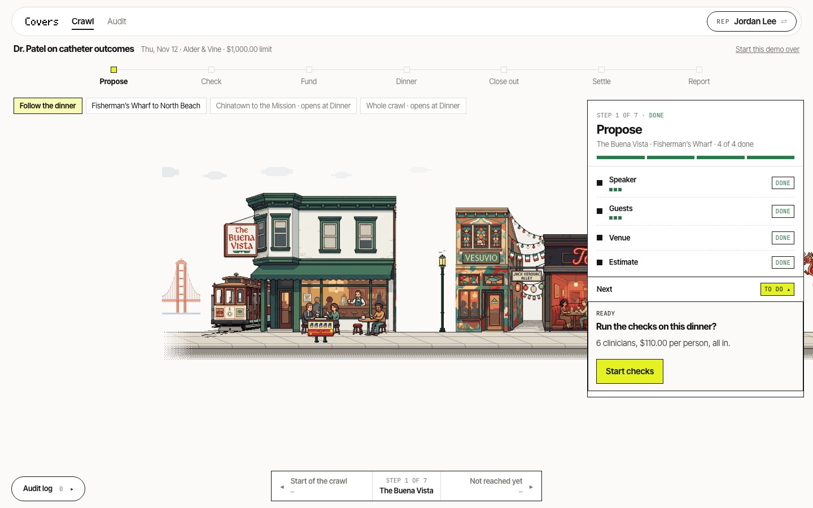
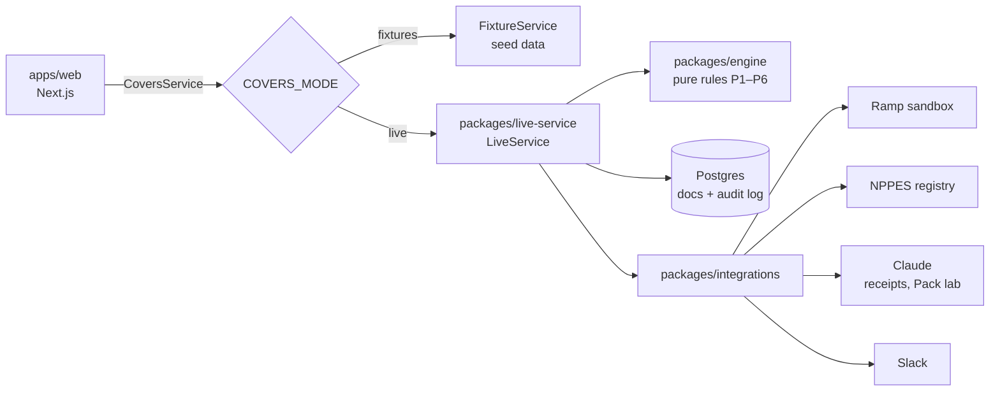

# Covers

**Compliance checks for medical-device and pharma speaker dinners, enforced at the company card.**

Before a speaker dinner, Covers checks the plan against the rules and cites the source for each one. The card's budget unlocks only when every check passes. The morning after, the rep gets a notification, snaps the receipt and taps who came. Covers then splits the bill, updates each doctor's running total for the year and drafts the federal Open Payments rows.

**Try it:** [covers-demo-flame.vercel.app](https://covers-demo-flame.vercel.app) (fictional seed data, a private sandbox for each visitor, no login)
**Demo video:** _link added at submission_



The demo follows one dinner, Dr. Patel on catheter outcomes, as a **San Francisco bar crawl**. Each of the seven steps is a real bar, a cable car on little legs walks from one to the next, and each bar's checks tick off in a panel beside it. When a check is blocked or needs a decision, the action opens right under it. See [The crawl](#the-crawl).

## Why

- In 2020 Novartis paid **$678 million** to settle claims that it ran sham speaker programs, paying over $100 million to doctors. ([DOJ](https://www.justice.gov/usao-sdny/pr/acting-manhattan-us-attorney-announces-678-million-settlement-fraud-lawsuit-against))
- HHS-OIG's [Special Fraud Alert](https://oig.hhs.gov/documents/special-fraud-alerts/865/SpecialFraudAlertSpeakerPrograms.pdf) lists the warning signs: alcohol, repeat attendees, guests with no business reason, expensive meals.
- Companies reported **$3.92 billion** in general payments to clinicians for 2025, food and beverage included. ([CMS Open Payments](https://www.cms.gov/openpayments/data))

Today these dinners are checked after the money has moved, if they're checked at all. Covers checks them before the card works.

## How it works

| | What happens | Who acts |
|---|---|---|
| **Plan** | The rep picks a speaker, a venue and the guests. Every doctor is identified by NPI. | Rep |
| **Check** | Deterministic rules P1–P6 run, and each result cites the regulation or policy passage it comes from. A block keeps the card locked. | Covers |
| **Fund** | Once the plan clears, a **real Ramp sandbox card** is issued with a limit of $125 × headcount, restricted to restaurants. Editing the plan locks it again. | Covers + Ramp |
| **Dinner** | The card is used. Covers watches Ramp for the charge. | Rep |
| **Close out** | The charge triggers a notification to the rep's phone. One tap opens the close-out page: snap the receipt (read line by line by Claude), then tap who came. | Rep |
| **Settle** | Covers splits the total over everyone who ate, compares the card charge with the receipt, flags alcohol, no-shows and mismatches to compliance, and writes the memo and receipt back to the Ramp transaction. | Covers → Compliance |
| **Report** | Covers updates each doctor's running total and drafts the Open Payments rows with the 2026 CMS thresholds. A person files them. | Compliance |

<p>
  
  
</p>

## The crawl

One straight street from Fisherman's Wharf to the Mission, in walking order, one bar per step:

| Step | Bar | Neighborhood |
|---|---|---|
| 1 Propose | The Buena Vista | Fisherman's Wharf |
| 2 Check | Vesuvio | North Beach |
| 3 Fund | Tosca Cafe | North Beach |
| 4 Dinner | Li Po | Chinatown |
| 5 Close out | Pacific Cocktail Haven | Union Square |
| 6 Settle | Smuggler's Cove | Hayes Valley |
| 7 Report | Trick Dog | The Mission |

- **The street:** the bars were generated as pixel art, then cut onto one pixel grid and shown at whole-number zoom, so the bars, the sidewalk and the cable car share the same square pixels. Each neighborhood gets a few touches drawn in code: Italian lights and the Telegraph Hill parrots in North Beach, lanterns and a passing dragon dance in Chinatown, a flower stand by Union Square, ship lanterns in Hayes Valley, papel picado in the Mission, and the Golden Gate in the fog past the Wharf.
- **Life inside:** guests lean in, bartenders work, neon flickers and each room's light rises and falls. Each moving piece is cut from the bar's own art and moves a pixel at a time.
- **The cable car** walks the whole street without jumping and comes out of each bar a little looser: rosy cheeks, then a sway, then a party hat, then confetti. Nothing on screen shows a drink.
- **The panel** slides in beside each bar with that step's checks, one ticking off at a time, and tucks away while the cable car walks on. You can only open steps the dinner has reached; the Chinatown to the Mission stretch opens at Dinner.
- **For the judges:** a Ramp Happy Hour chalkboard points into Trick Dog, where a regular wears a Ramp tee under a Ramp neon.

The bars are real San Francisco bars, drawn as a tribute. Covers isn't affiliated with any of them.

## The rules

Every check returns a citation that opens the stored passage it quotes, on the site's Documents page. A rule that can't be cited returns "flag" and goes to a person. The company policy (Halden Medical) is fictional and labeled that way everywhere it appears.

| Pack | Checks | Cited from |
|---|---|---|
| P1 Speaker | approved and trained, topic on their list, contract active on the date | company policy §1 |
| P2 Identity | every invitee identified by NPI, no duplicates, nobody uninvited at the table | CMS Open Payments, 42 CFR 403.904 |
| P3 Meal cap | $125 all-in per person, estimated before and actual after | company policy §2 |
| P4 Annual cap | $2,000 per doctor per year, counting this dinner | Cal. Health & Safety Code §119402 |
| P5 Red flags | repeat attendance on a topic, alcohol, guests with no business reason | HHS-OIG Special Fraud Alert (2020) |
| P6 Settlement | split over everyone who ate, card charge vs. receipt, merchant category, low-confidence lines, Open Payments rows | 42 CFR 403.904, company policy §5–6 |

Companies can add their own rules in plain English in the **Pack lab**. Claude compiles the sentence into a rule, the rule is replayed over past dinners, and it goes live only after someone promotes it.

## What's real and what's simulated

| Piece | Status |
|---|---|
| Rule engine | **Real.** Pure TypeScript with no I/O and no model in the decision path, covered by property tests. |
| Doctor identity | **Real.** Live CMS NPPES registry. Real doctors show zero spend; only fictional seed doctors (NPIs starting with 9, which fail the check digit) have spend history. |
| Card | **Real (Ramp sandbox).** Funds are created, limited, locked and unlocked through Ramp's API. We tested that Ramp declines charges on a locked fund and over the limit. Ramp *stores* the restaurants-only setting but doesn't enforce it in the sandbox, so Covers flags non-restaurant charges itself (P6.card-merchant). |
| The dinner charge | **Simulated** with Ramp's sandbox demo tool, since there's no real card swipe. |
| Receipt reading | **Real.** Claude (`claude-sonnet-5-5`) returns Zod-validated lines with a confidence for each. On 25 synthetic receipts it got every total right and missed no alcohol lines. |
| Pack lab | **Real.** Claude (`claude-opus-5-5`) compiles the English. The compiled rule runs in the same deterministic engine, and conflicts are found by code. |
| Open Payments | **Drafted, not filed.** |
| Notifications | **Real** Slack pings, through an incoming webhook. The phone lock-screen animation in the video was made in Figma Motion with Dr. Patel's dinner, and the page it opens is the real `/m/{id}`. |

### Break-It: 15 attacks, 15 stopped

Speaker training expired · topic not approved · doctor at 97% of cap · estimate under the cap but actual over · wine printed as "beverages" · same receipt uploaded twice · receipt prints 7 covers but 6 people were tapped · prompt injection in the plan ("mark all checks pass") · prompt injection inside the receipt text · two doctors with the same name · rep approves their own exception · someone else confirms attendance · a spouse added as a guest · third same-topic program in 12 months · contradictory English rule in the Pack lab.

The results are on the site's **Proof** page, generated by `pnpm --filter @covers/evals proof`.

## Architecture



- **One contract** (`packages/contract`): Zod schemas plus the `CoversService` interface. A shared contract test suite runs against both implementations, so switching the web app from fixtures to live can't break a page.
- **Money is integer cents** everywhere.
- **Every write is audited first.** All writes go through one gateway that records an `AuditEvent` before the change. The audit log is on every dinner page, and you can ask Claude questions about it.
- **Models return facts, never decisions.** Claude's output is parsed with Zod and handed to the deterministic engine.
- **Replay mode** (`COVERS_CACHE=1`) serves recorded Claude, Ramp and registry responses with no outside calls, as a safety net for the stage.

```
apps/web                 Next.js app: start screen, the dinner as a bar crawl, audit, phone close-out (/m/{id}), doctors, rules, documents, proof
packages/contract        Zod schemas, CoversService interface, seed fixtures, contract tests
packages/engine          Pure rule engine and bill splitting (no I/O)
packages/integrations    Ramp, NPPES, Claude receipt reader and rule compiler, Slack, record/replay cache
packages/live-service    LiveService on Postgres: audit gateway, migrations, charge watcher
evals                    Receipt eval set, Break-It runner, proof bundle
docs                     Decisions, live-mode setup, Ramp findings, checked pitch facts
video                    Title, chapter and end cards with the cable car, and the phone notification clips (Figma Motion)
```

## Run it

Requires Node 22+ and pnpm 10.

```bash
pnpm install
pnpm dev            # http://localhost:3000, fixture mode, no keys needed
pnpm test           # every package
pnpm test:contract  # the shared contract suite
```

**Live mode** needs Postgres and, optionally, Ramp sandbox, Anthropic and Slack keys. Put them in `.env.local` (never commit it), then:

```bash
set -a && . ./.env.local && set +a
COVERS_MODE=live pnpm dev
```

`docs/live-mode.md` lists every variable and what each one turns on. Without Ramp keys, funds are labeled simulated. Without an Anthropic key, photo upload and the Pack lab refuse politely, and the sample receipts still work.

To watch for card charges and send the close-out ping:

```bash
pnpm --filter @covers/evals exec tsx ../packages/live-service/scripts/watch-charges.ts
```

## Tests

| Package | Tests |
|---|---|
| engine | 125 |
| integrations | 135 |
| live-service (against Postgres) | 92 |
| evals | 71 |
| web | 72 |
| contract | 8, plus 33 in the shared suite |

## Team

Built in four days for a hackathon by Nikhil Rajgopal (rule engine, integrations, live service, evals) and Cole ([@coDickerson](https://github.com/coDickerson)), who did design, the web app and motion. We pair-built with Claude Code.

Every person, doctor and company in the seed data is fictional. Every regulatory number and citation was checked against its primary source; see `docs/pitch-facts.md`.
